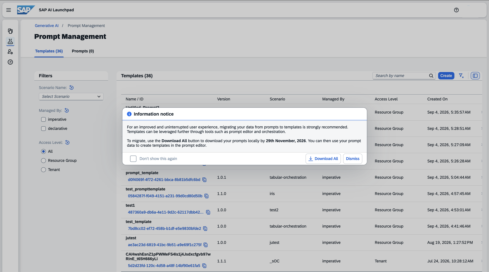
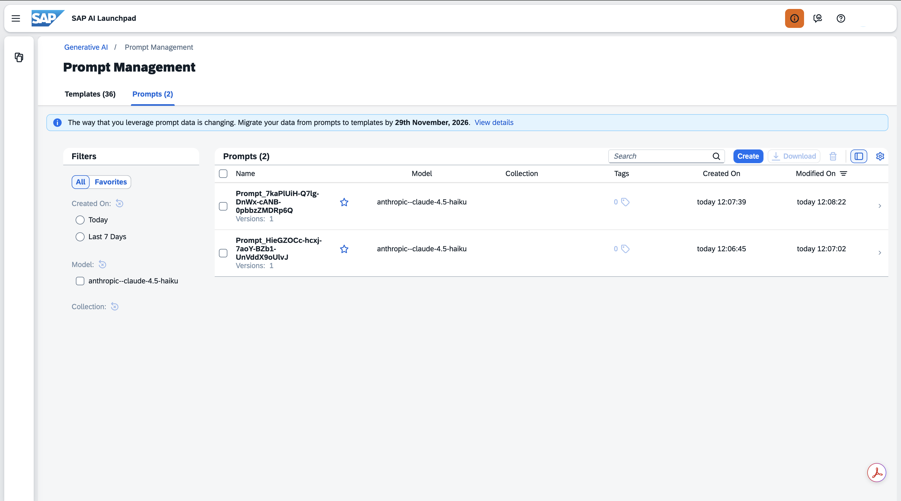

<!-- loiod07a272b22234d7a920f942a3d280c51 -->

# View a Saved Prompt

<a name="loiod07a272b22234d7a920f942a3d280c51__prereq_yxf_gyb_rzb"/>

## Prerequisites

You have either the `genai_manager` or `prompt_manager` role, or you are assigned a role collection that contains one of these roles. For more information, see [Roles and Authorizations](security-e4cf710.md#loio4ef8499d7a4945ec854e3b4590830bcc).

> ### Note:  
> Templates are saved in one region only and can only be retrieved or deleted by an instance of AI launchpad in that region.

> ### Note:  
> To ensure an uninterrupted user experience, migrate your data from prompts to templates.
> 
> By 29 November 2026, use *Download All* to download your prompts locally. You can then use the downloaded prompt data to create templates in the Prompt Editor. Templates also support additional capabilities such as Prompt Editor and Orchestration.

<a name="loiod07a272b22234d7a920f942a3d280c51__steps_zr4_pq5_jzb"/>

## Procedure

1.  Select the connection to your SAP AI Core runtime in the *Workspaces* app and choose the resource group that was used for your *Generative AI Hub* deployment.

2.  In the *Workspaces* app, expand the *Generative AI Hub* and choose *Prompt Management*.

    To download all prompts, click *Download All* in the information notice dialog box. After the download is complete, click *Dismiss* to close the dialog box.

    

3.  Select the *Prompts* tab.

    

    > ### Note:  
    > You can also download the selected prompt by clicking the *Download* button.

4.  **Optional:** You can

    -   Mark a prompt as favorite using the star icon.

    -   See the prompt details by selecting the prompt entry.

    -   See version details by selecting the version entry from the prompt details.

